<!--
  O README é um único canvas de 848px (moldura #08090D com orbs em gradiente) fatiado em
  imagens inline. O scripts/postbuild.mjs converte cada  para largura em % + align="top",
  para que as fatias se empilhem sem frestas. Toda fatia tem 848px de largura.

  Os gradientes da moldura são desenhados em coordenadas do canvas inteiro (846×1134, a área
  interna à borda); cada fatia desloca o mesmo SVG pelo seu topo (translate y negativo).
  Topos das fatias: 0 · 463.
-->

