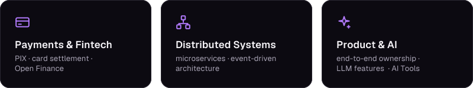
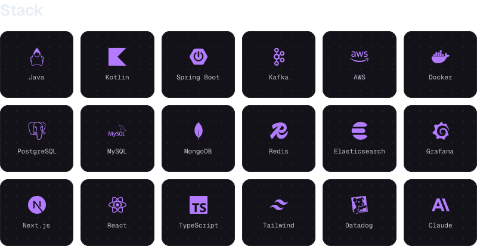
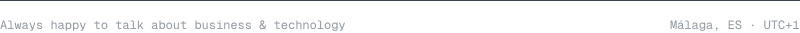

<details>
<summary>About (text version)</summary>

**José Vieira Neto** · Senior Software Engineer | Payments & fintech | Distributed Systems | Product, AI · Brazilian · based in Málaga, ES · remote only

8 years as a software engineer across fintech, banking and integration platforms. In payments and core banking, I've built instant payments (PIX), card settlement, Open Finance and high-volume transaction systems.

</details>

<p align="center">
<a href="mailto:josevieiraneto.dev@gmail.com"></a><a href="https://linkedin.com/in/josevieiraneto"></a>
</p>

<!-- Botões Website e Stackround: desativados até o deploy. Para reativar, preencha o link=,
     troque `disabled-aura` por `aura` e mova os blocos para logo após o do LinkedIn (sem linha em branco).
```disabled-aura width=132 height=46 link="[URL_DO_SITE]" inline align=center alt="Website"
<div style={{ width: 132, height: 46, display: 'flex', justifyContent: 'center' }}>
  <div style={{ display: 'flex', alignItems: 'center', gap: 8, height: 46, padding: '0 20px', borderRadius: 23, border: '1px solid #3A3644', background: '#0C0A11', color: '#F5F3F7', fontFamily: 'Geist', fontSize: 15 }}>
    <svg width="16" height="16" viewBox="0 0 24 24"><g transform="scale(0.666667)" fill="none" stroke="#F5F3F7" strokeWidth="2" strokeLinecap="round" strokeLinejoin="round"><circle cx="12" cy="12" r="10" /><path d="M2 12h20" /><path d="M12 2a15 15 0 0 1 4 10 15 15 0 0 1-4 10 15 15 0 0 1-4-10 15 15 0 0 1 4-10z" /></g></svg>
    <span>Website</span>
  </div>
</div>
```
```disabled-aura width=156 height=46 link="[URL_DO_STACKROUND]" inline align=center alt="Stackround"
<div style={{ width: 156, height: 46, display: 'flex', justifyContent: 'center' }}>
  <div style={{ display: 'flex', alignItems: 'center', gap: 8, height: 46, padding: '0 20px', borderRadius: 23, border: '1px solid #3A3644', background: '#0C0A11', color: '#F5F3F7', fontFamily: 'Geist', fontSize: 15 }}>
    <svg width="16" height="16" viewBox="0 0 24 24"><g transform="scale(0.666667)" fill="none" stroke="#B37BFF" strokeWidth="2" strokeLinecap="round" strokeLinejoin="round"><path d="M12 3l1.9 5.8L20 10l-6.1 1.2L12 17l-1.9-5.8L4 10l6.1-1.2z" /></g></svg>
    <span>Stackround</span>
  </div>
</div>
```
-->



![About. Building products end to end, from design to production. 8 years as a software engineer across fintech, banking and integration platforms. In payments and core banking, I've built instant payments (PIX), card settlement, Open Finance and high-volume transaction systems. I care about why we're building something, not just how, I work close to product and business and like owning the whole thing. Today I work fully remote for a Brazilian company and ship my own products, from Java and Spring Boot services to Next.js frontends and LLM-powered features.](./.github/assets/readme-aura-component-4-b13249ce.svg)





