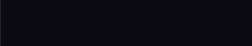
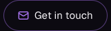
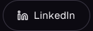
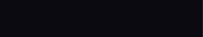
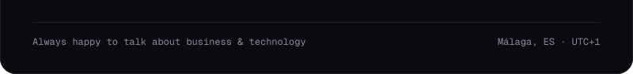

<!--
  O README é um único canvas (#0C0A11) fatiado em imagens inline. O scripts/postbuild.mjs
  converte cada  para largura em % + align="top", para que as fatias se empilhem sem
  frestas. Toda fatia tem 800px de largura; as peças da linha de botões somam 800px.
-->

<a name="aura-0"></a><a name="aura-1"></a><a href="mailto:josevieiraneto.dev@gmail.com"></a><a href="https://linkedin.com/in/josevieiraneto"></a><a name="aura-4"></a><a name="aura-5"></a><a name="aura-6"></a><a name="aura-7"></a>

<!-- Botões Website e Stackround: desativados até o deploy. Para reativar: preencha o link=,
     troque `disabled-aura` por `aura`, mova-os para entre o LinkedIn e o preenchimento da direita
     e reduza a largura dos dois preenchimentos para que a linha continue somando 800px.
```disabled-aura width=132 height=46 link="[URL_DO_SITE]" inline alt="Website"
<div style={{ width: 132, height: 46, background: '#0C0A11', display: 'flex', justifyContent: 'center' }}>
  <div style={{ display: 'flex', alignItems: 'center', gap: 8, height: 46, padding: '0 20px', borderRadius: 23, border: '1px solid #3A3644', background: '#0C0A11', color: '#F5F3F7', fontFamily: 'Geist', fontSize: 15 }}>
    <svg width="16" height="16" viewBox="0 0 24 24"><g transform="scale(0.666667)" fill="none" stroke="#F5F3F7" strokeWidth="2" strokeLinecap="round" strokeLinejoin="round"><circle cx="12" cy="12" r="10" /><path d="M2 12h20" /><path d="M12 2a15 15 0 0 1 4 10 15 15 0 0 1-4 10 15 15 0 0 1-4-10 15 15 0 0 1 4-10z" /></g></svg>
    <span>Website</span>
  </div>
</div>
```
```disabled-aura width=156 height=46 link="[URL_DO_STACKROUND]" inline alt="Stackround"
<div style={{ width: 156, height: 46, background: '#0C0A11', display: 'flex', justifyContent: 'center' }}>
  <div style={{ display: 'flex', alignItems: 'center', gap: 8, height: 46, padding: '0 20px', borderRadius: 23, border: '1px solid #3A3644', background: '#0C0A11', color: '#F5F3F7', fontFamily: 'Geist', fontSize: 15 }}>
    <svg width="16" height="16" viewBox="0 0 24 24"><g transform="scale(0.666667)" fill="none" stroke="#B37BFF" strokeWidth="2" strokeLinecap="round" strokeLinejoin="round"><path d="M12 3l1.9 5.8L20 10l-6.1 1.2L12 17l-1.9-5.8L4 10l6.1-1.2z" /></g></svg>
    <span>Stackround</span>
  </div>
</div>
```
-->
